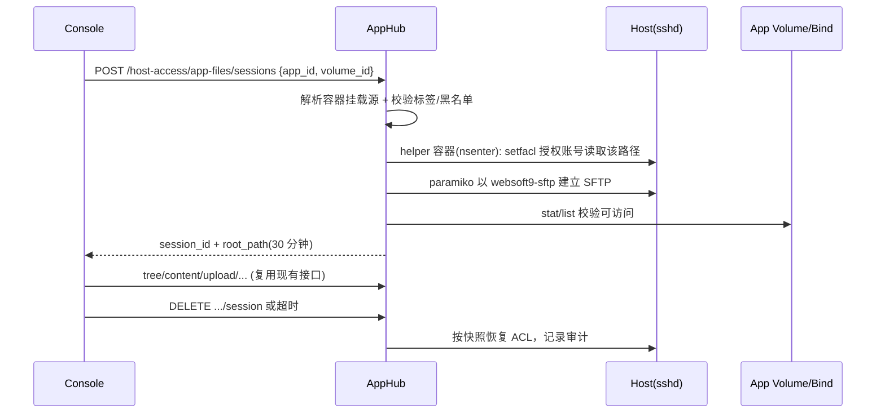

# 应用文件（SFTP）平台专用账号方案 — 实现文档

- 状态：已按本方案完成第一轮实现（未提交），见 §14 实现记录
- 适用版本：SFTP 属新功能，**仅面向新版本**，不涉及旧版本功能迁移或回滚
- 关联代码：`apphub/src/services/app_sftp.py`、`app_sftp_account.py`、`app_sftp_prepare.py`、`app_sftp_acl.py`、`sftp_path_authorization.py`、`apphub/src/api/v1/routers/host_access.py`

## 1. 背景

当前“我的应用 → 详情 → 数据 → SFTP”由 `HostAccessService.create_local_profile()` 自动准备：复用宿主机**已有账号**（可能是 root 或首个有 `authorized_keys` 的普通用户），把平台生成的公钥写入其 `authorized_keys`，并为非 root 账号追加 `/etc/sudoers.d/websoft9-local-sftp`，允许其 `NOPASSWD` 以 root 运行 `sftp-server`。

由此产生三个不可接受的问题：

1. `NOPASSWD sudo sftp-server` 实际以 root 读全盘，应用级路径限制只存在于 AppHub 的应用层（`ScopedSftp`），SSH 通道本身无边界；
2. 密钥挂在共享账号上，无法按操作员/应用归因与吊销；
3. 依赖“猜账号”（`SUDO_USER` → 唯一有 key 的普通用户 → root），跨云镜像行为不可预测。

因此改为：**平台持有单个专用系统账号**，仅用于 AppHub 服务端到宿主机的 SFTP 传输；**不向浏览器/用户下发凭据或端口**。

## 2. 设计决策

| 编号 | 决策 | 理由 |
| --- | --- | --- |
| D1 | 只建一个平台账号 `websoft9-sftp` | 账号数量与运维成本可控；避免每应用账号膨胀 |
| D2 | 账号无密码、无 shell、无 sudo、不入 docker 组，仅公钥登录 | 最小权限；删除 sudoers 依赖 |
| D3 | 授权按**会话**动态施加/回收（POSIX ACL），不做安装期静态白名单 | 卷源可为任意 bind mount，无法穷举 |
| D4 | 路径只能来自该应用容器的 `Mounts.Source`，不接受前端传入的路径 | 杜绝任意路径读写 |
| D5 | 凭据、端口不出服务器，浏览器仍走 AppHub 的 REST 文件接口 | 现状即服务端代理；减少暴露面 |
| D6 | 账号引导（bootstrap）在首次使用时由特权 helper 容器完成 | 产品以镜像更新交付，不能依赖重跑 `install/` 脚本 |
| D7 | Terminal 的手动/自动连接逻辑保持不变（`auto-local-*` 仅服务于终端） | 应用文件与终端解耦，避免牵连 |

非目标：不做每应用账号；不改云市场镜像与 `install/` 脚本；不做 SFTP 功能的历史数据迁移。

## 3. 总体调用链



## 4. 主机侧实现

### 4.1 账号

```bash
useradd --system --uid 2001 --user-group \
  --home-dir /var/lib/websoft9-sftp --create-home \
  --shell /usr/sbin/nologin websoft9-sftp
```

- 若 2001 已被其他用户占用：改用 `--system` 自动分配，把实际 uid/gid 写入状态文件，**不使用**已存在的同名/同 uid 账号（存在但不是本平台创建则失败关闭）。
- 家目录 `/var/lib/websoft9-sftp`（700，属主为账号本身），只存放 `.ssh/authorized_keys`。
- 账号不加入任何附加组；`/etc/sudoers.d/` 下**不为其创建任何文件**。

### 4.2 密钥

- 由 helper 在宿主 `ssh-keygen -t rsa -b 3072 -N ""` 生成，私钥写入 `{data_root}/config/host-access/sftp.key`（0600），公钥写入 `~websoft9-sftp/.ssh/authorized_keys`，行尾注释 `websoft9-platform-sftp`，行首选项 `restrict`。
- 私钥只由 AppHub 进程读取；不进入 API 响应、不落前端、不写日志。
- 支持重新生成（轮换）：新公钥先追加、验证通过后删除旧行与旧私钥文件。

### 4.3 sshd 配置

优先 drop-in：`/etc/ssh/sshd_config.d/60-websoft9-sftp.conf`

```
Match User websoft9-sftp
    PasswordAuthentication no
    KbdInteractiveAuthentication no
    PubkeyAuthentication yes
    PermitTTY no
    X11Forwarding no
    AllowAgentForwarding no
    AllowTcpForwarding no
    PermitTunnel no
    ForceCommand internal-sftp
```

- 若主配置未包含 `Include /etc/ssh/sshd_config.d/*.conf`（部分老发行版），退化为在主配置尾部写入 `# >>> websoft9-sftp` / `# <<< websoft9-sftp` 标记块。
- 写入前备份原文件；`sshd -t` 校验失败必须回滚并失败关闭。
- 生效方式：检测 `ssh.service` / `sshd.service` 后 `systemctl reload <unit>`；`reload` 失败（无 systemd）则要求下次登录自然生效并告警。
- 不设置 `ChrootDirectory`：应用路径是动态的，chroot 无法按会话变化；边界由“路径来源校验 + 文件权限”保证。

### 4.4 bootstrap（首次使用）

沿用现有特权 helper 模式（`host_access.py#_prepare_local_ssh_credentials`）：

```python
client.containers.run(
    image=<当前平台镜像 id>, entrypoint=['nsenter', '--target', '1', '--mount', '--net', '--pid', '--root', '--wd', '--'],
    command=['python3', '-c', script, data_root], privileged=True, pid_mode='host',
    network_mode='host', user='0', detach=True,
    labels={'owner': 'websoft9', 'websoft9.operation': 'prepare-app-sftp'},
)
```

流程（新脚本 `apphub/src/services/app_sftp_prepare.py`，替代 `host_access_prepare.py` 的应用文件分支）：

1. 依赖探测：`python3`、`sshd`、`ssh-keygen`、`getfacl`/`setfacl`；缺失则尝试 `apt-get install -y acl` / `dnf install -y acl`，仍失败则返回 409 并给出可执行提示。
2. 读取状态文件 `{data_root}/config/host-access/app-sftp-account.json`：`{version, username, uid, gid, key_path, sshd_mode, sshd_unit, fingerprint}`。
3. 账号：不存在则创建；存在则校验 `uid/gid/shell` 与状态一致，否则失败关闭。
4. sshd：按 4.3 写入并校验；`fingerprint` 记录配置块哈希，运行期发现漂移则重写一次。
5. 密钥：按 4.2 生成/校验，公钥缺失时补写。
6. 用 paramiko 以该账号打开 SFTP 并 `stat('/')` 验证（`ForceCommand internal-sftp` 下不能执行 shell）。
7. 成功写状态文件（原子写 + `os.replace`）；任一步失败则回滚（删本次新增的 sshd 块/公钥行，恢复备份）并返回错误码。

幂等性：并发调用用 `flock` 文件锁（`{data_root}/config/host-access/.app-sftp.lock`）；helper 容器带标签便于异常残留清理。

### 4.5 依赖与 SELinux

- **ACL**：`setfacl` 不可用或文件系统不支持（`setfacl` 返回 `Operation not supported`）→ 失败关闭，返回 409 `SFTP ACL Unsupported`，提示该数据目录所在文件系统不支持 ACL。宿主需预装 `acl` 包（Debian/Ubuntu `apt-get install acl`），helper 不会自动联网安装。
- **SELinux**：`getenforce` 为 `Enforcing` 时，先用 `ausearch -m avc -ts recent` 检查 `sshd_t` 对目标路径的拒绝。若被拒绝且无法通过 `semanage fcontext` 归入允许类型，则本功能对该应用返回 409，并在提示中说明“需关闭 SELinux 或改用容器内文件浏览”，不做 `setenforce 0`、不做 `semanage permissive`。
- 该验证在实现前作为 Phase 0 spike 在 Anolis/CentOS 上先行确认（见 §12）。

## 5. 路径解析与授权

### 5.1 卷 ID 语义扩展

当前 `volume_id` 只是 Docker 卷名，且卷列表来自“带 `com.docker.compose.project` 标签的 Docker 卷”，**bind mount 根本不在列表里**。需要：

- 后端卷列表（`app_manager._group_volumes_by_app` 结果）补充来自容器 `Mounts` 的 bind 项，合成 ID：`volume:<name>` / `bind:<sha256(source)[:16]>`；
- 前端 `getVolumeId()` 兼容两种前缀，展示路径取 `Source`；
- 兼容旧数据：无前缀的值按 `volume:<value>` 处理。

### 5.2 解析与校验（新 `SftpPathResolver`）

输入仅 `app_id`、`volume_id`；返回 `{source_path, destination, container_name, container_uid, container_gid}`。

1. 列出该 `com.docker.compose.project == app_id` 的运行中容器，取 `Mounts` 中匹配 `volume_id` 的项；`volume` 型读 `Mountpoint`，`bind` 型读 `Source`。
2. `source_path` 必须绝对路径、存在、是目录；`realpath` 后不得与原始值不一致（符号链接目录拒绝）。
3. 黑名单（规范化后前缀匹配）：`/`、`/etc`、`/root`、`/proc`、`/sys`、`/dev`、`/boot`、`/usr`、`/bin`、`/sbin`、`/lib*`、`/var/run`、`/var/lib/docker`、`/var/lib/kubelet`、`{data_root}/config`、`{data_root}/upgrade`、`{data_root}/repository`。
4. 允许但需显式提示的目录：`/home/*`、`/data`、`/srv`、`/var/www`、`/opt/*`（`/opt/websoft9` 除外）。
5. `container_uid/gid` 取目标容器 `Config.User`（空 = root/0）；用于属主兼容授权。
6. 同一 `volume_id` 在一个容器内被挂载多次 → 422；多个容器挂载同一源 → 取容器名排序第一个，并在响应中返回 `source_container` 便于排查。

### 5.3 ACL 授权与还原

在宿主执行（helper 容器，nsenter）：

```bash
# 1) 快照（root 路径，非递归）
getfacl -p --absolute-names "$PATH" > /tmp/w9sftp-$SESSION.acl

# 2) 授权：账号读写 + 双向默认 ACL（新文件对应用容器仍有权限）
setfacl -m u:websoft9-sftp:rwX \
       -m d:u:websoft9-sftp:rwX \
       -m d:u:<container_uid>:rwX \
       -m d:m:rwX "$PATH"
```

- 记录**实际新增**的条目（`getfacl` 解析判断原本是否存在）与原 mask 值，写入 `host_sftp_acl_grants`；释放时只删除“本次新增”的条目并还原被修改的 mask。
- 根目录快照保存 ACL 文本，异常/超时可用 `setfacl --restore=<file>` 精确还原。
- 存量文件若因属主/权限不可写：在该路径上按需做**最小递归**授权（仅当操作返回 `EACCES` 时触发），限制 `find` 数量（默认 20000）与超时（60s），记录被授权的子路径清单，释放时逐项还原。避免“打开即全量 `-R`”拖垮大卷。

### 5.4 属主与 chmod

- 账号新建的文件 uid 为 `websoft9-sftp`，通过 `d:u:<container_uid>:rwX` 让应用容器仍可读写；反向 `d:u:websoft9-sftp:rwX` 保证后续编辑可用。
- `chmod` 会重算 ACL mask，可能把账号权限压掉。处理：
  - `ScopedSftp.chmod` 执行后立即在 **同一 SFTP 通道**无法修复 ACL，改为登记“待修复路径”，下次打开会话时重新施加；
  - UI 属性面板的 chmod 仍保留，但文档化该限制；
  - 不允许通过 SFTP 改属主/属组（现状已禁止，保持）。

## 6. 会话模型

- 会话记录在 `{data_root}/config/host-access/host-access.sqlite`：

```sql
CREATE TABLE host_sftp_sessions (
  session_id TEXT PRIMARY KEY, operator_id TEXT NOT NULL,
  app_id TEXT NOT NULL, volume_id TEXT NOT NULL, root_path TEXT NOT NULL,
  container_uid INTEGER NOT NULL DEFAULT 0,
  state TEXT NOT NULL,              -- active | released | failed
  created_at TEXT NOT NULL, last_seen_at TEXT NOT NULL, released_at TEXT
);
CREATE TABLE host_sftp_acl_grants (
  id INTEGER PRIMARY KEY AUTOINCREMENT, session_id TEXT NOT NULL, path TEXT NOT NULL,
  entry TEXT NOT NULL, original_value TEXT, applied_at TEXT NOT NULL, released_at TEXT
);
CREATE TABLE host_sftp_account_state (
  key TEXT PRIMARY KEY, value TEXT NOT NULL, updated_at TEXT NOT NULL
);
```

- TTL 30 分钟、滑动续期（每次请求更新 `last_seen_at`）；空闲 10 分钟自动释放。
- 释放时机：`DELETE /host-access/app-files/{id}/session`、TTL 到期、应用卸载、`AppSftpService` 进程重启（启动时 reconcile 所有 `state='active'`）。
- reconcile 幂等：先删新增 ACL 条目，再按需 `setfacl --restore`；ACL 还原失败只告警并保留 `state='failed'`，供设置页诊断，不阻塞其他会话。
- 每个操作员最多 3 个并发会话，超限返回 409（已有 `ConnectionLimitError` 可复用）。

## 7. AppHub 代码改造点

| 文件 | 改动 |
| --- | --- |
| `apphub/src/services/app_sftp_prepare.py`（新增） | 账号/sshd/密钥 bootstrap、状态文件、幂等与回滚；由 helper 容器在宿主执行 |
| `apphub/src/services/sftp_path_authorization.py`（新增） | 路径解析、黑名单、ACL 施加/快照/还原、grant 记账 |
| `apphub/src/services/app_sftp.py` | `create()` 改为“解析 → 授权 → 建连 → 落库”；删除 `_prepare_elevated_sftp`、`volume_root` 对 bind 的限制；新增 `release()`；`access()` 更新 `last_seen_at` |
| `apphub/src/services/app_volume_browse.py` | 抽出共用的挂载解析逻辑（`_resolve_container_mount` 支持 bind）供两处复用 |
| `apphub/src/services/app_manager.py` | 卷列表补充 bind 项与合成 ID |
| `apphub/src/services/host_access.py` | 应用文件不再调用 `create_local_profile`；终端逻辑保留；新增账号状态查询/强制重建入口 |
| `apphub/src/api/v1/routers/host_access.py` | `DELETE .../session` 改为调用 `release()`；新增 `GET /host-access/app-files/account`、`POST /host-access/app-files/account/prepare` |
| `apphub/src/api/v1/routers/myapp_volume_browse.py` | bind 卷浏览沿用同一解析器 |

## 8. API 变更

- `POST /host-access/app-files/sessions`：请求体去掉 `profile_id` 依赖（保留字段向后兼容但忽略）；响应用 `account`（`websoft9-sftp`）替代 `username`，不返回密钥。
- `DELETE /host-access/app-files/{session_id}/session`：必须释放 ACL 后返回。
- 新增 `GET /host-access/app-files/account`：`{state: ready|unavailable|drifted, username, uid, sshd_mode, detail}`，供设置页诊断。
- 新增 `POST /host-access/app-files/account/prepare`：强制重新 bootstrap（需认证 + 审计记录）。
- 新增错误码：`SFTP Account Unavailable`(409)、`SFTP Path Unsupported`(422)、`SFTP ACL Unsupported`(409)、`SFTP Authorization Failed`(500)、`SFTP Container Not Running`(409)。

## 9. 前端与文案

- `console/src/features/my-apps/app-sftp-dialog.tsx`：连接失败时改为调用 `POST /host-access/app-files/account/prepare`，不再调用 `/host-access/profile/local`。
- `console/src/features/terminal/terminal-page.tsx#AppFileConnectionPrompt`：确认弹窗文案必须修改——现在是“**不创建操作系统账号**”，新方案会创建专用系统账号，需改为：创建受限系统账号（无登录 shell、无 sudo、仅服务端使用），并说明不会改动现有账号与 SSH 策略。
- 相关 i18n 键：`sftpAutomaticConfirmAccount`、`sftpAutomaticConfirmPermissions`、`sftpAutomaticConfirmKey`、`sftpAutomaticConfirmIntro`，中英双语同步。
- `console/src/features/terminal/app-file-sessions.ts`：新增错误码到文案的映射。
- 对话窗口不展示账号名以外的凭据信息，不提供“下载密钥”。

## 10. 审计

- 结构化日志：`sftp.account.prepare`（结果/耗时/sshd_mode）、`sftp.session.open` / `sftp.session.release`（operator_id、app_id、volume_id、source_path、container_uid、结果、耗时）。
- 文件操作沿用现有请求日志，新增写类操作（上传/删除/重命名/移动/chmod）的路径与大小记录，不记录文件内容。
- 可选：`{data_root}/config/host-access/sftp-audit.jsonl`（按日切分、保留 7 天），用于跨重启追溯。

## 11. 安全与已知限制

已消除：共享账号密钥、`NOPASSWD sftp-server`、猜测账号逻辑。

仍然存在（需在发布说明中明示）：

1. 单账号意味着**应用间无 OS 级隔离**：持私钥者可读已被 ACL 授权的任意路径；私钥仅存服务器，风险边界等于“AppHub 进程被攻破”。
2. 会话期间 ACL 残留窗口（最长 TTL）；进程被强杀时依赖下次启动 reconcile。
3. `chmod` 可能改变 ACL mask，导致账号临时无权限，需重新打开会话修复。
4. 无 ACL 支持的文件系统、SELinux Enforcing 且策略不允许的路径，功能不可用（失败关闭）。
5. bind mount 到 `/home` 等目录时，ACL 会作用于该目录，可能与同目录其他服务共享权限；响应中需返回 `source_path` 供操作员确认。

## 12. 测试与验收

单元/集成（`apphub/tests`）：

- 路径解析：命名卷、bind、多次挂载、不符标签、黑名单、符号链接、缺失路径。
- ACL：施加/新增条目判定/mask 还原/快照恢复；不支持 ACL 的文件系统 mock。
- 会话：TTL、并发上限、reconcile 幂等、释放后再次打开、应用卸载时释放。
- bootstrap：重复执行幂等、uid 冲突、`sshd -t` 失败回滚、Include 缺失回退。

环境矩阵（手工）：

| 场景 | 期望 |
| --- | --- |
| Ubuntu 22.04/24.04 | 账号与 sshd drop-in 生效，SFTP 可用 |
| Debian 12（最小安装） | 缺 `acl` 时自动安装或给出明确 409 |
| Anolis/CentOS（SELinux Enforcing） | Phase 0 结论落地；不允许则 409 并给出指引 |
| 无 systemd reload 路径 | 提示重启 sshd 生效，功能不静默失败 |
| bind mount 到 `/data`、`/home/u/www` | 可读写，`source_path` 正确回显 |
| 上传新文件后应用容器读写 | 双向 default ACL 生效 |
| 会话超时/浏览器关闭/AppHub 重启 | ACL 被还原，无残留条目 |

验收标准：`getfacl` 在会话结束后与快照一致；`sshd` 对该账号仅允许 sftp 子系统；`sudo -l -U websoft9-sftp` 无任何条目；私钥不出服务器。

## 13. 实施顺序

1. Phase 0：SELinux + ACL 可行性 spike（Anolis/CentOS/Ubuntu 各一台）。
2. 路径解析与卷列表扩展（含 bind 合成 ID），先让“数据”页浏览可用。
3. bootstrap + 账号/sshd/密钥 落地，加状态查询与诊断接口。
4. 会话授权/释放/reconcile，替换 `AppSftpService.create`。
5. 前端文案与错误映射，移除对 `/host-access/profile/local` 的依赖。
6. 环境矩阵验证 + 发布说明（含已知限制）。

## 14. 实现记录（第一轮）

已落地：

- 新增 `app_sftp_prepare.py`：创建/校验 `websoft9-sftp`、写入 sshd drop-in（无 `Include` 时回退主配置标记块）、生成密钥与 `restrict` 公钥、状态文件，重复执行幂等。
- 新增 `app_sftp_acl.py`：会话级 ACL 申请/释放，含祖先目录穿越授权、根目录 ACL 快照与还原、有上限的递归授权（20000 项 / 60 秒）与逐项掩码回填。
- 新增 `sftp_path_authorization.py`：卷/bind 解析、应用标签校验、系统路径黑名单、容器 UID 识别、会话台账（`sftp-authorization.sqlite`）与启动 reconcile。
- 新增 `app_sftp_account.py`：helper 容器引导、状态查询、私钥读取与登录校验。
- `AppSftpService` 改为“解析 → 准备账号 → ACL 授权 → 建连验证”，新增 `release()`、`account_status()`、`account_prepare()`；删除 `volume_root` 与 `_prepare_elevated_sftp`。
- `open_host_sftp()` 不再传 `elevated=True`，应用文件通道彻底去掉 `sudo sftp-server`。
- 路由：`DELETE .../session` 先释放 ACL；新增 `GET/POST /host-access/app-files/account[/prepare]`。
- 前端：自动建立改调 `/account/prepare`，错误码映射与中英文案同步。
- 测试：`tests/test_host_access.py` 更新为平台账号模型；新增 `tests/test_sftp_platform_account.py`（卷/bind 解析、黑名单、ACL 辅助函数），共 85 例通过；控制台 `tsc -b` 通过。

本轮未做（与 §13 对应）：

- 卷列表尚未把 bind mount 暴露为可选项（后端 `AppVolumeBrowseService`/卷列表仍只列 Docker 卷）；本轮先支持已传入 `bind:<hash>` 的解析，UI 侧留待下一步。
- SELinux Enforcing 环境的实测与策略处理、无 `acl` 包时自动安装，均未在真实云主机验证。
- `chmod` 后的 ACL 掩码修复仍依赖重新打开会话。
- 会话审计日志（§10）以现有 logger 为准，未单独落 jsonl。

### 14.1 dev 环境真实验证（2026-10-22）

环境：Ubuntu 26.04 宿主 + `websoft9-dev` 容器（root，挂载 docker.sock），SELinux 未启用。

验证结果：

- 宿主安装 `acl` 后（`apt-get install acl`，需绕过失效的本机代理），`ensure(force=True)` 成功：创建 `websoft9-sftp`（uid 2001）、写入 `/etc/ssh/sshd_config.d/60-websoft9-sftp.conf`、生成密钥，paramiko 公钥登录并打开 SFTP 成功。
- 命名卷会话：`w9sftptest_data`（属主 root、mode 755）授权后可在 `_data` 内创建/写入/读取；会话释放后 `getfacl` 与快照完全一致，manifest 目录为空。
- 自定义 bind 目录：`/srv/w9sftbind`（父目录 700）+ `/data` 挂载，解析为 `bind:<hash>`；会话期间父目录被授予 `u:websoft9-sftp:--x`，释放后恢复为无 ACL。
- 双向属主：SFTP 新建文件为 `websoft9-sftp`，通过 default ACL 让容器用户（uid 999）继续可写（实测追加成功）。
- 重启 AppHub 后，遗留 `active` 会话被 reconcile 回收，ACL 还原。
- 网关验证：`/api/host-access/app-files/account` 未登录 401、登录后返回 `ready`；带会话 Cookie 创建/关闭会话均正常；新前端 bundle 含 `/account/prepare`。
- 安全约束：`/etc/sudoers.d` 无平台规则；账号仅属自身组、无登录 shell；sshd 配置仅允许 sftp 子系统。

验证中发现并修复：

- 父进程与宿主 helper 同时 `flock` 同一个 `.app-sftp.lock` 导致死锁（表现为 docker wait 读超时）→ helper 改用 `.app-sftp-prepare.lock`。
- 黑名单 `/var/lib/docker` 会误拦所有命名卷 → 放行 `/var/lib/docker/volumes/<name>/_data`，其余仍拒绝。
- 测试镜像直接用 `sleep infinity` 会因镜像 entrypoint 覆盖而立即退出 → 测试需显式 `--entrypoint sleep`。

### 14.2 交互与性能修正（2026-10-22 第二轮）

- **保留原交互**：仅当平台账号尚未准备时，进入 SFTP 先弹窗让用户选“手动建立 / 自动建立”；自动建立仍需二次确认（告知会创建系统账号、临时特权容器、ACL 范围、密钥仅存服务端）。账号就绪后再次进入直接打开文件管理，不再重复询问。
- **授权边界**：`AppSftpService.create()` 不再隐式创建账号；账号未准备时返回 409 `SFTP Account Unavailable`，只有用户确认后调用 `POST /account/prepare` 才会引导。已就绪时该接口仅做状态检查（实测 0.03s）。
- **首屏延迟**：打开会话只对卷根做非递归 ACL（实测热请求 0.85s、重启后首请求 1.07s，含 helper 容器启动与 SFTP 建连）。子目录在操作返回 `EACCES` 时按需授权并重试一次（实测 0.86~0.97s），不再一次性递归 2 万项。
- **懒授权回滚缺陷**：`grant` 对目标子目录施加了 ACL 却未记录快照，导致释放后残留 `user:websoft9-sftp`。现改为先快照目标 ACL 再施加，`release` 逐项还原，实测释放后条目数为 0。
- 每次 SFTP 会话**不会**重建账号：账号与密钥只在首次确认时创建，之后仅做状态读取与 ACL 操作。
- 专用账号**不会**出现在终端主机列表：它是服务端专用账号（无登录 shell、无密码），用户无法也无需用它登录；终端主机列表仍只展示用户自建连接。

> 该条已被 §14.3 取代：账号现在以只读条目出现在主机列表，可删除。

### 14.3 主机列表可见与可删除（2026-10-22 第三轮）

- `GET /host-access/profile` 在 `saved_profiles` 首位注入只读条目 `profile_id=platform-sftp`（`managed=true`），来源为 `{data_root}/config/host-access/app-sftp-account.json` + `sftp.key` 是否存在。
- 前端主机列表为该条目显示「平台专用」徽标，隐藏测试/编辑/连接按钮，仅保留删除；快捷连接列表已过滤该条目。
- `DELETE /host-access/profiles/platform-sftp` 走专用分支：先释放所有应用文件会话（还原 ACL），再执行 helper `revoke`：
  - 删除 `authorized_keys` 中的 `websoft9-platform-sftp` 行；
  - 删除 `sftp.key` 与状态文件；
  - 删除 sshd drop-in（或主配置标记块）并 `sshd -t` + reload；
  - **保留系统账号本身**（无 shell/无密钥，无法登录），下次确认自动建立时复用。
- 实测：删除后列表条目消失、`sshd_config.d` 无平台配置、密钥与状态文件消失、`authorized_keys` 无平台公钥；重新 `POST /account/prepare` 后条目恢复且登录校验通过。

### 14.4 打开文件视图的延迟优化（2026-10-22 第四轮）

真实浏览器实测（本机网关，`我的应用 → 数据 → SFTP` 点击到文件工具栏可见）：

| 场景 | 优化前 | 优化后 |
| --- | --- | --- |
| 首次打开（新建会话） | 2.2~2.8s | **1.4s** |
| 30 分钟内再次打开（复用会话） | 1.1~1.6s | **0.32~0.58s** |

关键修复：

- **深层递归授权是真正的大头**：进入无权限子目录时会 `os.walk` 最高 2 万项并逐项 `getfacl/setfacl`，实测单个 manifest 达 1.2MB，请求可卡 20s 以上。改为**浅层授权**：只给目标目录及其直接子项授权（上限 500 项），实测 200 个子项仅 0.6s、manifest 28KB；更深层级在进入时再授权。
- **启动清理移出关键路径**：遗留会话 reconcile 改为启动后 3s 在后台执行，避免与首个会话的 helper 容器争抢。
- **会话复用**：前端为已验证会话记录 `verified_at`，60s 内重进不再做一次 tree 校验。
- **连接预热**：会话创建后异步建立并缓存 SSH/SFTP 连接，首次 `tree` 由 ~700ms 降到 ~130ms。
- **即时反馈**：账号已就绪、会话建立期间显示「正在建立连接并检查应用目录访问权限...」，不再出现点击后界面无变化。
- 会话创建本身约 0.8s，主要成本是宿主 ACL helper 容器启动；这是当前架构下的下限。

### 14.5 按应用长期授权（方案 A，2026-10-22 第五轮）

为减少临时容器，授权从“每会话施加/撤销”改为“每应用一次，保留到应用移除”：

- 账号准备（v2）时给 `/var/lib/docker/volumes` 加 `u:websoft9-sftp:rwX` + `d:u:websoft9-sftp:rwX` + `d:m:rwX`，**之后新建的卷自动继承**，无需任何 helper（实测新建卷可见继承条目）。
- 首次访问某应用目录才起一次 helper 授权，并把 `grant_id / app_id / root_path` 记入 `sftp_grants` 表；后续会话与文件操作**不再起容器**（实测会话创建从 908ms 降到 136ms，目录树 80ms）。
- 关闭文件视图只结束会话记录，**不撤销 ACL**；30 分钟会话过期同理。
- 回收时机：`uninstall_app` / `remove_app` / `remove_error_app` 调用 `revoke_application_grants(app_id)`；AppHub 启动后后台检查 `sftp_grants`，对“应用已不存在（无容器且无卷）”的记录回收，覆盖 `compose down -v`、Portainer 手工删除等情况。
- 已知边界：
  - v2 之后新建的命名卷，其 ACL 来自继承，应用移除时仍保留该账号条目（属于方案 A 的“广泛授权”语义）；bind 目录则按授权快照精确回收。
  - 首次写入旧的、属主为容器用户的目录时可能仍触发一次 helper 授权（浅层、按目录），之后长期有效。
  - `chmod` 压低 ACL mask、SFTP 新建文件属主为 `websoft9-sftp` 的限制不变。

实测：首次授权 908ms，之后同一应用重新进入 136ms（页面 SPA 导航约 0.3s）；卸载回收返回 `released: 1` 且授权表清空。

### 14.6 连接删除、手动入口与已有本地连接（2026-10-22 第六轮）

- **删除平台连接即断开**：`revoke_account` 除释放会话与授权外，还会清空 `HostAccessService._file_browser_clients` 中所有缓存的 SSH/SFTP 连接；前端监听 `host-profile-deleted`（`platform-sftp`）后关闭全部应用文件会话、禁用文件操作并提示已撤销。实测删除后旧会话 `tree` 返回 403、会话列表清空。
- **手动入口预填**：从应用文件入口进入“新建连接”时，自动勾选“本地主机”、主机填平台本地地址、名称填卷 ID（实测名称/勾选/主机均正确）。
- **已有本地连接不再重复询问**：后端在平台账号缺失但操作员存在本地连接时自动 `ensure()` 创建账号；仅当既无平台账号也无本地连接时才返回 409 由前端弹窗确认。
- 注意：删除平台连接会同时清空所有应用的授权（`release_all`），下次进入会重新授权一次（约 0.9s）。

### 14.7 本地连接优先与手动入口（2026-10-22 第七轮）

- **可用的本地连接优先复用**：`AppSftpService.create` 先查找“`is_local` 且 `has_password || has_private_key`”的已保存连接（显式传入 → 活跃 → 默认 → 其它），命中则直接用该连接建立会话（`mode=profile`，不创建平台账号、不施加 ACL、不弹确认）；只在**没有可用本地连接**时才走平台账号，仍缺少时返回 409 由前端确认授权。
- **不再静默创建账号**：删除了“存在本地连接就自动 `ensure()`”的逻辑。
- **手动入口优化**：从应用文件入口打开“新建连接”时，名称预填 `websoft9-local`，勾选并**锁定**“本地主机”，主机字段同步锁定为平台本地地址。
- **文案简化**：`SFTP Account Unavailable` 不再在弹窗中显示长错误（与 `sftpConnectionRequired` 一样只显示操作选项）。
- **修复删除连接 500**：`invalidate_profile` 对 `mode=profile` 会话缺少顶层 `profile_id` 抛 `KeyError`，改为兼容 `session['profile']['profile_id']`。
- 验证：存在可用本地连接且平台账号缺失时点击 SFTP → 直接进入（会话 `profile_id` 为该连接，账号仍为 missing）；手动弹窗名称/锁定状态正确；删除连接返回 200。

### 14.8 断开状态展示（2026-10-22 第八轮）

删除平台连接后，文件视图此前会残留骨架屏且标题仍像在线。现改为：

- 前端收到 `platform-sftp` 删除事件时：终止在途请求、清空目录/编辑器/属性/剪贴板状态、置 `browserLoading=false`，保留 `appFileSession`（`status='ended'`）以免丢失标题与路径。
- 渲染层以会话状态优先：`ended` 时不再显示骨架行（`browserLoading && status !== 'ended'`），加载进度条同样受控。
- 标题栏保留原连接名（如 `websoft9-sftp@172.17.0.1`）并追加「（已断开）」，文件工具栏、按钮全部禁用。
- 实测：删除后骨架数为 0，标题显示 `websoft9-sftp@172.17.0.1 （已断开）`，路径保留，工具按钮 `disabled`。
- 页签保留：删除平台连接时不再 `closeAppFileSession`（不删 sessionStorage 条目），而是把每个应用文件会话标记为 `ended`；顶部会话页签（多个应用同时打开时）全部保留、状态点转红，切换页签显示同一断开状态。文件区中间显示「（已断开）」而不是“目录为空”。

> 最终按旧版本对齐：标题不加后缀，文件区显示红色 `目录读取失败：当前主机连接已失效，无法访问应用文件。`（`browserErrorTitle` + `sftpConnectionUnavailable`），路径与页签保留、工具按钮禁用；`（已断开）` 标识与文案已移除。


